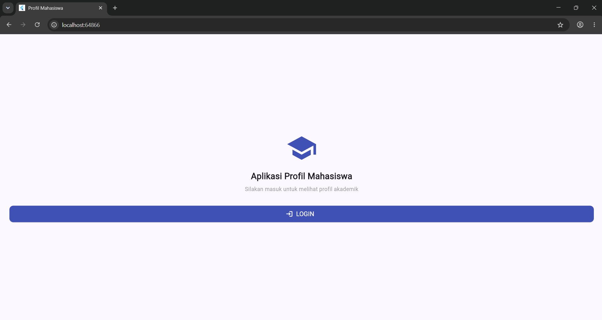
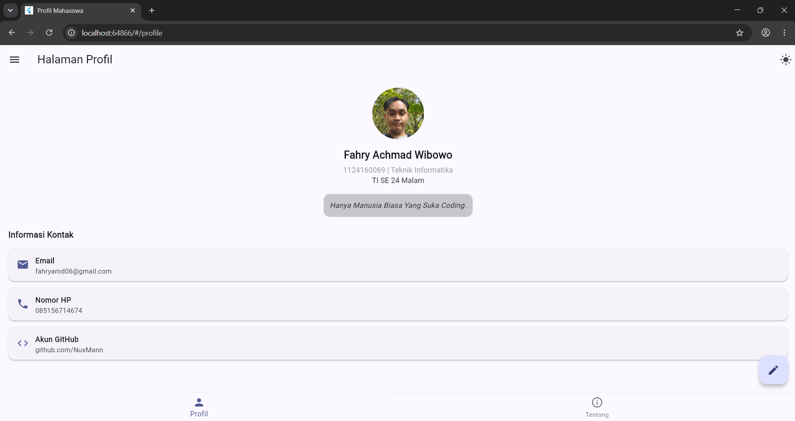
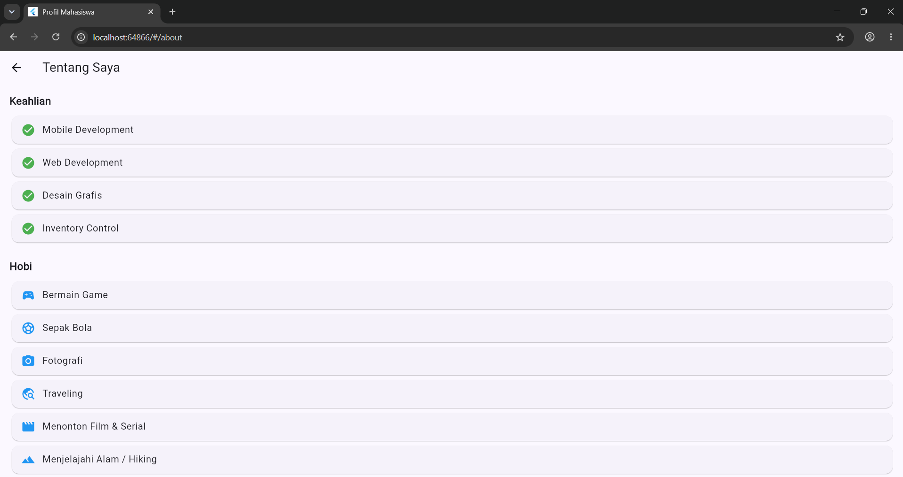

# 📱 Aplikasi Profil Mahasiswa - Flutter (Soal 2)

<p align="center">
  
</p>

<p align="center">
  
  
  
  
</p>

Aplikasi mobile berbasis **Flutter** yang dikembangkan untuk memenuhi Ujian Tengah Semester (UTS). Aplikasi ini menampilkan halaman profil pribadi lengkap dengan sistem navigasi, form validasi, manajemen *state* lokal, serta dukungan mode tema terang dan gelap (*Dark/Light Mode*).

---

## 👨‍💻 Identitas Mahasiswa
* **Nama Lengkap:** Fahry Achmad Wibowo
* **NIM:** 1124160069
* **Program Studi:** Teknik Informatika (S1)
* **Kelas:** TI SE 24 Malam
* **GitHub:** [@NuxMann](https://github.com/NuxMann)

---

## 🎥 Video Demonstrasi
[](https://youtu.be/LJ21L0rmHco)  
*(Klik tombol di atas untuk menonton video demo aplikasi)*

---

## 📸 Tangkapan Layar (Screenshots)

 Halaman Login   Halaman Profil Utama    Halaman About Page Profil   Halaman Edit Profil  Dark Mode 

---

## ✨ Daftar Fitur Utama
1. **Autentikasi Sederhana (Login Page):** Gerbang awal masuk ke aplikasi dengan tombol navigasi utama.
2. **Halaman Profil Dinamis:** 
   - Foto profil dari folder `assets/images/` menggunakan `CircleAvatar`.
   - Informasi lengkap: Nama, NIM, Prodi, Kelas, Bio singkat, dan Kontak (Email, No. HP, GitHub) menggunakan `Card` & `ListTile`.
3. **Halaman Edit Profil & Validasi:**
   - Form interaktif dengan nilai awal dari `TextEditingController`.
   - Validasi ketat: Nama wajib diisi, format email valid, dan nomor HP khusus angka (10–13 digit).
   - Pengembalian data secara instan ke Halaman Profil menggunakan `Navigator.pop(context, dataBaru)` dan pembaruan UI via `setState()`.
4. **Halaman Tentang Saya (*About*):** Memuat daftar keahlian/hobi serta riwayat pendidikan yang disusun rapi menggunakan `ListView`.
5. **Scaffold Lengkap:** Menggunakan kombinasi `AppBar`, `Drawer` (menu samping), `BottomNavigationBar`, dan `FloatingActionButton`.
6. **Tema Kustom (Dark & Light Mode):** Tombol/switch dinamis di dalam aplikasi yang mengubah `themeMode` secara langsung tanpa *restart*.
7. **Kustomisasi Android:** Nama aplikasi di perangkat terubah menjadi **Profil** (melalui atribut `android:label` di `AndroidManifest.xml`).

---

## 🚀 Cara Menjalankan Proyek

Pastikan Anda sudah menginstal **Flutter SDK** di komputer Anda. Jalankan perintah berikut di terminal:

1. **Clone repository ini:**
   ```bash
   git clone [https://github.com/NuxMann/uts-pml-1124160069.git](https://github.com/NuxMann/uts-pml-1124160069.git)
   cd uts-pml-1124160069/soal2-profil-app

2. **Jalankan Flutter Clean untuk Clean Flutter:**
   ```bash

   flutter clean

3. **Jalankan Flutter Pub Get:**
   ```bash

   flutter pub get

4. **Running: dan pilih crhrome**
   ```bash

   flutter running

   
## 📱 Download APK

Klik tombol di bawah untuk mengunduh aplikasi Android.

[⬇️ Download APK](https://github.com/NuxMann/uts-pml-1124160069/releases/latest)

