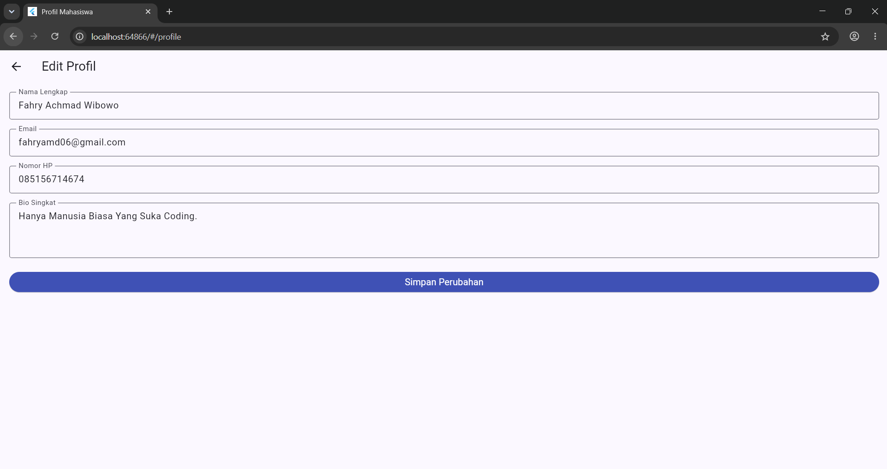
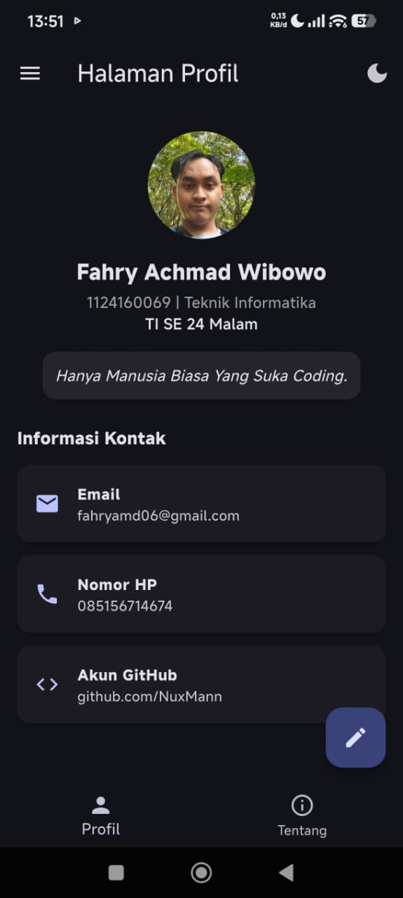

 
<div align="center">

# 📱 APLIKASI PROFIL MAHASISWA

### Flutter Mobile Application — UTS Soal 2


<br/>


**Aplikasi Profil Mahasiswa berbasis Flutter**

[📥 Download APK](https://github.com/NuxMann/uts-pml-1124160069/releases/latest) •
[🎥 Video Demo](https://youtu.be/LJ21L0rmHco) •
[💻 GitHub Repository](https://github.com/NuxMann/uts-pml-1124160069)

</div>

---

## 📖 Tentang Proyek

Aplikasi mobile berbasis **Flutter** yang dikembangkan untuk memenuhi Ujian Tengah Semester (UTS).

Aplikasi ini menampilkan halaman profil pribadi yang dilengkapi sistem navigasi, form validasi, manajemen *state* lokal, serta dukungan mode tema terang dan gelap (*Dark/Light Mode*).

Proyek ini dibuat sebagai implementasi pemahaman pengembangan aplikasi mobile menggunakan Flutter dan bahasa pemrograman Dart.

---

## 👨‍💻 Identitas Mahasiswa

| Informasi | Detail |
|---|---|
| **Nama Lengkap** | Fahry Achmad Wibowo |
| **NIM** | 1124160069 |
| **Program Studi** | Teknik Informatika (S1) |
| **Kelas** | TI SE 24 Malam |
| **GitHub** | [@NuxMann](https://github.com/NuxMann) |
| **Mata Kuliah** | Pemrograman Mobile |

---

## 🎥 Video Demonstrasi

<div align="center">

[](https://youtu.be/LJ21L0rmHco)

**Klik tombol di atas untuk melihat demonstrasi aplikasi.**

</div>

---

## 📸 Preview Aplikasi

<div align="center">

### 🔐 Login Page


### 👤 Halaman Profil Utama


### ℹ️ About Page


### ✏️ Edit Profil


### 🌙 Dark Mode


</div>

---

## ✨ Fitur Utama

| No. | Fitur | Deskripsi |
|---|---|---|
| 01 | 🔐 Login Page | Autentikasi sederhana sebagai halaman awal aplikasi. |
| 02 | 👤 Dynamic Profile | Menampilkan foto, nama, NIM, prodi, kelas, bio, dan kontak. |
| 03 | ✏️ Edit Profile | Mengubah informasi profil melalui form interaktif. |
| 04 | ✅ Form Validation | Validasi nama, email, dan nomor HP. |
| 05 | ℹ️ About Page | Menampilkan keahlian, hobi, dan riwayat pendidikan. |
| 06 | 🧭 Navigation | Menggunakan AppBar, Drawer, BottomNavigationBar, dan FAB. |
| 07 | 🌙 Dark & Light Mode | Mengubah tema aplikasi secara dinamis tanpa restart. |
| 08 | 📱 Android Customization | Mengubah nama aplikasi pada perangkat menjadi Profil. |

### 🔍 Detail Implementasi

**1. Autentikasi Sederhana**
- Halaman login sebagai gerbang awal aplikasi.
- Tombol navigasi menuju halaman utama.

**2. Halaman Profil Dinamis**
- Foto profil menggunakan `CircleAvatar`.
- Informasi profil menggunakan `Card` dan `ListTile`.
- Data meliputi nama, NIM, prodi, kelas, bio, email, nomor HP, dan GitHub.

**3. Edit Profil dan Validasi**
- Menggunakan `TextEditingController`.
- Nama wajib diisi.
- Email harus memiliki format valid.
- Nomor HP hanya angka dengan panjang 10–13 digit.
- Data dikembalikan menggunakan `Navigator.pop(context, dataBaru)`.
- UI diperbarui menggunakan `setState()`.

**4. About Page**
- Menampilkan keahlian, hobi, dan riwayat pendidikan.
- Menggunakan `ListView`.

**5. Dark & Light Mode**
- Menggunakan pengaturan `themeMode`.
- Perubahan tema dapat dilakukan secara langsung tanpa restart aplikasi.

---

## 🛠️ Teknologi yang Digunakan

<div align="center">


</div>

| Teknologi | Fungsi |
|---|---|
| Flutter | Framework pengembangan aplikasi |
| Dart | Bahasa pemrograman |
| Android Studio | IDE pengembangan |
| Material Design | Komponen antarmuka |
| Git & GitHub | Version control dan repository |

---

## 🚀 Cara Menjalankan Proyek

### 1. Clone Repository

```bash
git clone https://github.com/NuxMann/uts-pml-1124160069.git
```

### 2. Masuk ke Folder Proyek

```bash
cd uts-pml-1124160069/soal2-profil-app
```

### 3. Bersihkan Cache Proyek

```bash
flutter clean
```

### 4. Install Dependencies

```bash
flutter pub get
```

### 5. Jalankan Aplikasi

```bash
flutter run
```

**Catatan:** Pastikan Flutter SDK sudah terinstal dan emulator atau perangkat Android sudah terhubung.

---

## 📱 Download APK

<div align="center">


<br/><br/>

### Ingin mencoba aplikasi secara langsung?

[](https://github.com/NuxMann/uts-pml-1124160069/releases/latest)

**Unduh aplikasi melalui GitHub Releases.**

</div>

---

## 📊 GitHub Statistics

<div align="center">


</div>

---

## 🐍 Contribution Animation

<div align="center">


</div>

---

<div align="center">

### 💙 Thank You for Visiting!


**Developed by Fahry Achmad Wibowo**

© 2026 — Flutter Student Profile Application

</div>
